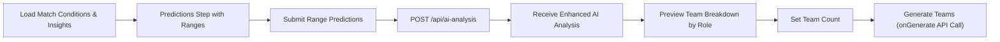
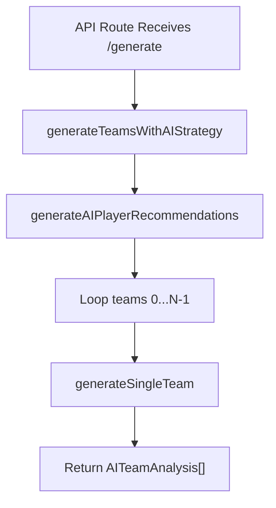

# Strategy 3: Score & Storyline Prediction

## 1. Introduction
**Strategy 3** uses match conditions and your own score predictions to drive an AI analysis, then generates diversified fantasy teams based on the analysis. The strategy now uses **range inputs** instead of exact scores (e.g., "120-160 runs", "Under 120 runs"), displays **match insights** alongside predictions, and provides clear **team breakdown** with role distributions (BAT, AR, WK, BWL) for each generated team. It combines automated data-driven insights with user intuition for optimized line-ups.

## 2. User Workflow

1. **Auto-Detected Match Conditions** (`components/strategies/Strategy3Wizard.tsx`, conditions step)
   - Format, pitch, weather, venue loaded via `useMatchData(matchId)`
   - **Match Insights Display**: Insights such as pitch/weather and past form displayed on the same page as predictions to help guide team generation
   - Click **Next: Make Predictions**

2. **Make Your Predictions** (`predictions` step)
   - **Range Inputs**: Users select ranges instead of exact scores using intuitive selectors:
     - "120-160 runs", "Under 120 runs", "160+ runs" for each team
     - Pre-defined ranges: "Low (100-130)", "Medium (130-160)", "High (160+)"
   - For T20/ODI/Test: enter expected run ranges and wicket ranges or detailed innings predictions and top performers
   - **Match Context**: Weather, pitch, and venue information displayed alongside prediction inputs
   - Click **Next: AI Analysis** once all fields are complete

3. **AI Analysis** (`analysis` step)
   - Invokes POST `/api/ai-analysis` with match conditions and `userPredictions` (now including ranges)
   - AI returns structured analysis JSON incorporating range-based predictions
   - **Enhanced Analysis**: AI considers range predictions for more nuanced team building
   - Once analysis completes, UI advances to **Generation**

4. **Generate Teams** (`generation` step)
   - Select number of teams (1–50)
   - **Team Breakdown Preview**: Shows expected role distributions (BAT, AR, WK, BWL) for each team
   - Click **Generate X Teams** button
   - Calls:
     ```ts
     onGenerate({ 
       strategy: 'differential',
       aiAnalysis,
       userPredictions: {
         team1Range: { min: 120, max: 160 },  // NEW: Range instead of exact
         team2Range: { min: 100, max: 150 },
         matchType: 'high-scoring' | 'low-scoring' | 'balanced'
       },
       matchConditions: { format, pitch, weather, venue },
       team1Name,
       team2Name
     }, teamCount)
     ```

### 2.1 Frontend Workflow Diagram

**Diagram Explanation:**
- Steps A→B present conditions with match insights and collect range predictions
- C→D kicks off AI analysis with range-based logic; D→E stores enhanced analysis
- F→G shows role breakdown preview before final generation
- G→H triggers final team-generation API call

**Example Range Workflow:**
- **User Input**: "India 120-160 runs, Pakistan 100-150 runs"
- **AI Response**: Teams generated with heavier focus on Indian batsmen and Pakistani bowlers, considering the expected match flow and range uncertainty

## 3. Backend Logic

### 3.1 AI Analysis API
- **File**: `app/api/ai-analysis/route.ts`
- Accepts POST body: `{ team1, team2, format, pitch, weather, venue, userPredictions }`.
- Builds prompt combining match context and user predictions.
- Calls `aiService.generateAnalysis(prompt)`.
- Returns `{ analysis: string }` JSON string containing analysis.

### 3.2 Team Generation API
- **File**: `app/api/teams/generate/route.ts`
- Validates input: `matchId, strategy==='differential', teamCount, userPreferences` (`aiAnalysis`, `userPredictions`, `matchConditions`, `team1Name`, `team2Name`).
- Calls `aiService.generateTeamsWithAIStrategy(request)`.
- Returns array of `AITeamAnalysis`.

### 3.3 AI Service Pipeline
**File**: `lib/ai-service-enhanced.ts`

1. **Entry Point**: `generateTeamsWithAIStrategy(request)`
   ```ts
   console.log(`🎯 Processing strategy: ${request.strategy}`);
   // No special branch for 'differential' → default fallback
   const recommendations = await this.generateAIPlayerRecommendations(request.matchId);
   const teams: AITeamAnalysis[] = [];
   for (let i = 0; i < request.teamCount; i++) {
     teams.push(await this.generateSingleTeam(recommendations, request, i));
   }
   return teams;
   ```

2. **generateAIPlayerRecommendations(matchId)**
   - Fetches player pool and runs ML model to produce scores (`confidence`, `role`, `reason`, `captaincy_score`).

3. **generateSingleTeam(recommendations, request, teamIndex)**
   - Determines valid Dream11 compositions.
   - **Groups** recommendations by role.
   - **Filters & sorts** by `confidence`.
   - **Selects** players per role respecting credits and team limits.
   - **Fills** remaining slots if under 11.
   - **Validates** composition; falls back if invalid.
   - **Picks** captain/vice-captain via `forceVariedCaptainSelection`.
   - Returns `AITeamAnalysis` with: `players, captain, viceCaptain, totalCredits, roleBalance, riskScore, expectedPoints, confidence, insights`.

#### 3.3 Backend Workflow Diagram

**Diagram Explanation:**
- API route delegates to AI service.
- AI service scores players, then assembles each team with Dream11 constraints.
- Final teams returned to frontend.

## 4. Key Formulas & Rules

- **Runs/Wickets Mapping**: `high/medium/low` → approximate ranges.
- **Team Composition**: Exactly 11 players, ≤100 credits, max 7 from one team.
- **Captain Selection**: `teamIndex % eligibleCaptains.length`.
- **Player Confidence**: 0–1 score from ML model, drives sorting.

## 5. Data Sources & Dependencies

- **Hooks**: `useMatchData(matchId)` for match context.
- **API**: `/api/ai-analysis`, `/api/teams/generate`.
- **AI Models**: `openAIService` / `geminiService`.
- **Validator**: `Dream11TeamValidator`.

## 6. AI Confidence & Insights

- Each `AITeamAnalysis` includes a `confidence` score.
- `insights` may incorporate AI analysis details and narrative rationale.

## 7. Next Steps

- Integrate `aiAnalysis` into `applyStrategyFiltering` to weight picks.
- Build specialized branch in `generateTeamsWithAIStrategy` for 'differential'.
- Enhance fallback to respect user top-performer predictions.
- Add UI preview of AI insights before final generation.

---
*Generated on {{date}} by Dream11 AI-Intern2025*
